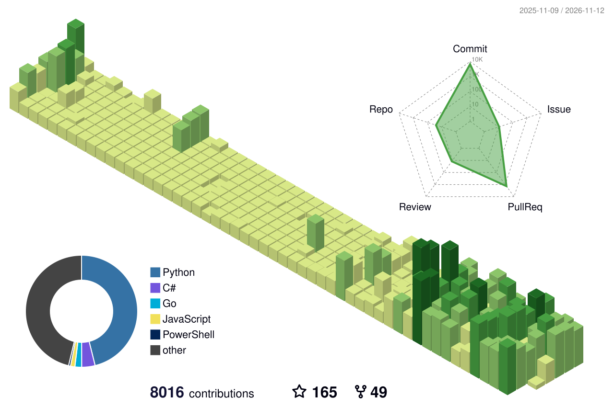

<div align="center" width="100%">
<div align="center">

<!-- ANIMATED HEADER BANNER -->


> *Architecting **intelligent, high-performance systems** — .NET · AI/ML · Quant · Edge.*


<!-- TYPING ANIMATION -->
   

[](https://git.io/typing-svg)


<br/>

<!-- PROFILE VIEWS + FOLLOWERS BADGES -->


</div>


##  About Me

<div align="left">

```yaml
name        : Capsizer
alias       : Opselon
company     : Piron
role        : [ .NET Architect, AI/ML Engineer, Quant Developer ]
interests   : [ AI/ML, Real-Time Systems, Distributed Architecture, Trading ]
stack       : [ C#, .NET, Python, TypeScript, Go ]
status      : Architecting intelligent, high-performance systems 🛠️
```
</div>

> *"Complexity is the enemy of reliability — architect it away."*


##  Tech Stack


<div align="center">

| # | Category | Icons |
|---|---|---|
| 🔤 | **Languages** | [](#) |
| 🎨 | **Frontend** | [](#) |
| ⚙️ | **Backend & Data** | [](#) |
| 🤖 | **AI / ML** | [](#) |
| 🚀 | **DevOps** | [](#) |
| 🧰 | **Tools** | [](#) |

</div>


##  GitHub Stats


<div align="center">

[](https://git.io/streak-stats)


</div>


##  Featured Projects

<div align="center">

[](https://github.com/Opselon/NexusTradingForexBot)
[](https://github.com/Opselon/ForexTradingBot)

</div>


##  3D Contribution Map

<div align="center">

<picture>
    <source media="(prefers-color-scheme: dark)" srcset="./profile-3d-contrib/profile-night-green.svg" />
    
  </picture>

</div>


##  Analytics

<div align="center">


</div>


##  Contribution Snake

<picture>
    <source media="(prefers-color-scheme: dark)" srcset="https://raw.githubusercontent.com/Opselon/Opselon/output/github-contribution-grid-snake-dark.svg">
    <source media="(prefers-color-scheme: light)" srcset="https://raw.githubusercontent.com/Opselon/Opselon/output/github-contribution-grid-snake.svg">
    
</picture>


##  Contributions 

<picture>
    <source media="(prefers-color-scheme: dark)" srcset="https://raw.githubusercontent.com/Opselon/Opselon/output-pacman/pacman-contribution-graph-dark.svg">
    <source media="(prefers-color-scheme: light)" srcset="https://raw.githubusercontent.com/Opselon/Opselon/output-pacman/pacman-contribution-graph.svg">
    
</picture>


##  Quote

<div align="center">

</div>


##  Connect With Me

<div align="center">

[](https://t.me/Capxi)
[](mailto:opcelon@gmail.com)

</div>


<div align="center">

<!-- FOOTER WAVE -->


**⭐ If you like what you see, consider starring some repos!**

</div>

</div>
